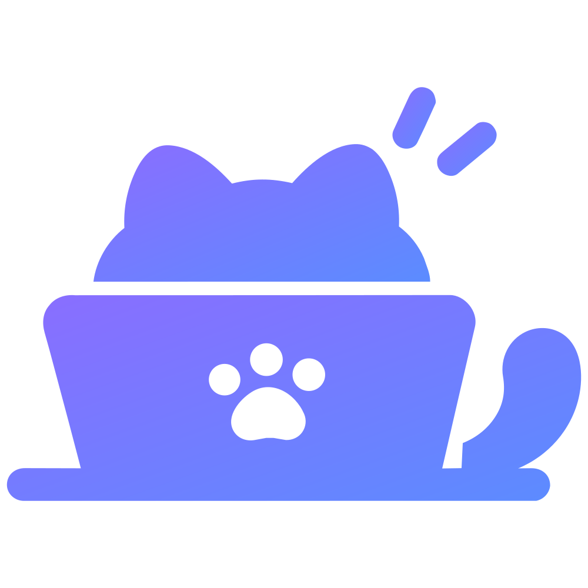
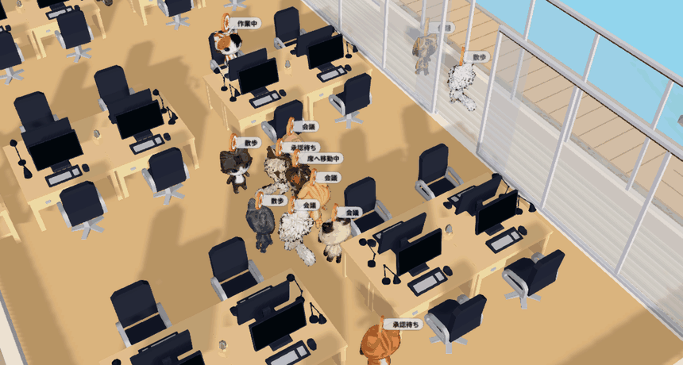
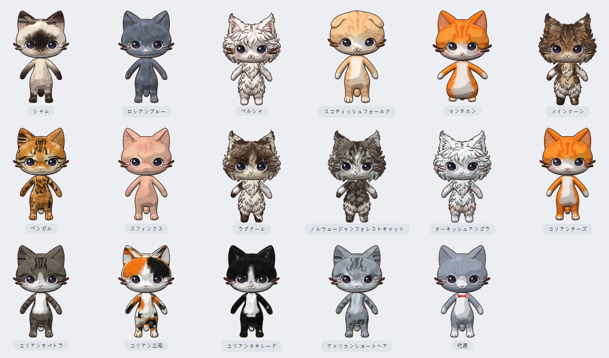
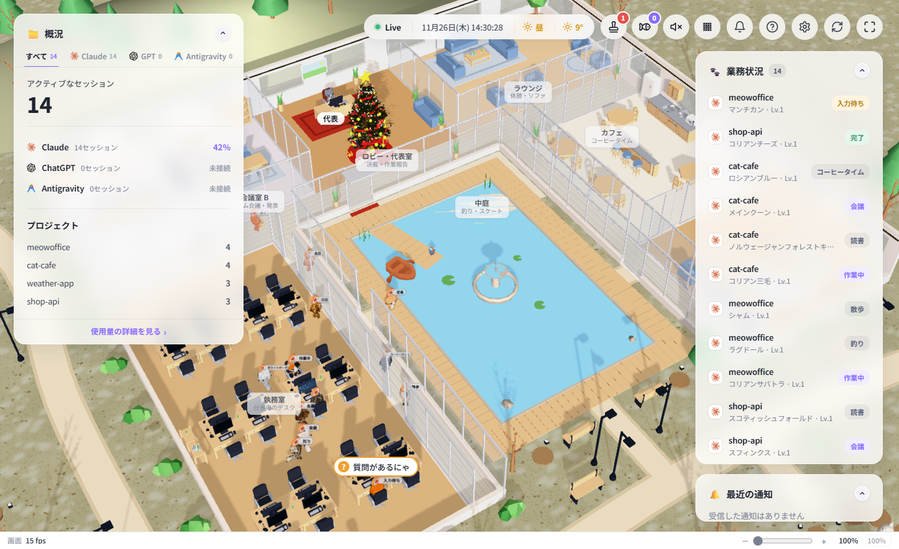
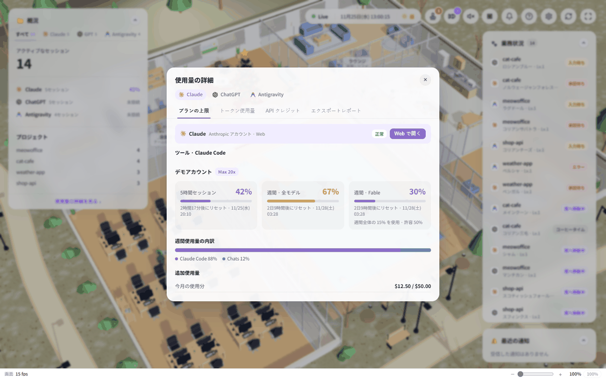
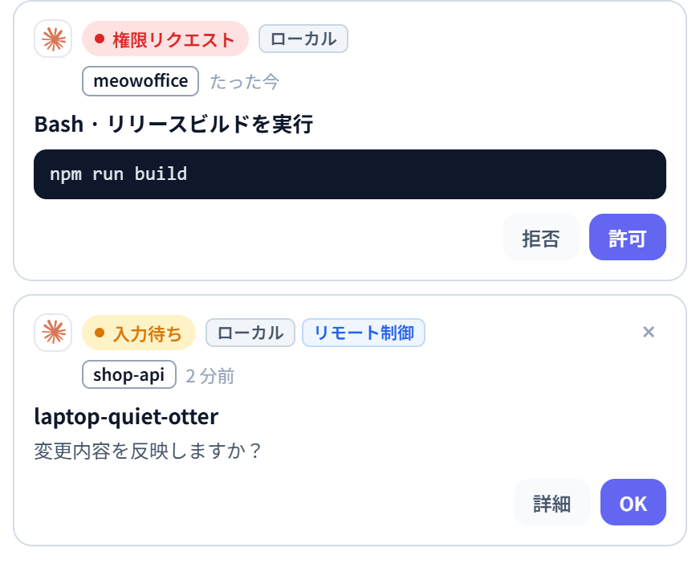

<p align="center">
  
</p>
<h1 align="center">Meowffice</h1>
<p align="center"><b>AI コーディングのセッションが 1 つずつ、ネコの社員として出勤します。</b></p>
<p align="center">
  <a href="README.md">English</a> | <a href="README.ko.md">한국어</a> | <b>日本語</b>
</p>
<p align="center">
  <a href="https://github.com/MuneoAX/meowoffice/releases/latest"></a>
  <a href="https://github.com/MuneoAX/meowoffice/releases"></a>
  
  <a href="https://github.com/MuneoAX/meowoffice/stargazers"></a>
</p>

AI コーディングのセッションが 1 つずつ **ネコの社員** として出勤するデスクトップオフィスです。
時計の横のトレイに Claude Code · Codex (ChatGPT) · Antigravity の **使用量の上限** を表示し、
セッションが権限・回答・レビューを待っているときは **通知カード** をポップアップします。3D オフィスのウィンドウでは、作業中のセッションがネコになって動き回ります。

Windows 10/11 · macOS (Rust + Tauri v2、素の HTML·CSS·JS、Babylon.js)

<p align="center">
  
</p>

<!-- download:start — scripts/release.mjs updates the version on each release -->
### ⬇ 最新バージョン v0.6.9 をダウンロード

| OS | ファイル |
|---|---|
| Windows 10/11 | [Meowffice_0.6.9_x64-setup.exe](https://github.com/MuneoAX/meowoffice/releases/download/v0.6.9/Meowffice_0.6.9_x64-setup.exe) |
| macOS (Intel · Apple Silicon) | [Meowffice_0.6.9_universal.dmg](https://github.com/MuneoAX/meowoffice/releases/download/v0.6.9/Meowffice_0.6.9_universal.dmg) |

他のバージョンは [すべてのリリース](https://github.com/MuneoAX/meowoffice/releases) から。セットアップの注意点は [インストール](#インストール) をご覧ください。
<!-- download:end -->

> **これは非公式アプリです。** Anthropic、OpenAI、Google とは提携しておらず、承認も受けていません。
> Claude、ChatGPT、Codex、Gemini、Antigravity はそれぞれの所有者の商標であり、このアプリは使用量がどのサービスのものかを示すためだけに名称とロゴを使用しています。

---

## 主な機能

- **使用量トレイ**: 5 時間・週間の上限をリングゲージで表示、モデル別のトークン使用量 (この PC のログに基づく)、リセットまでの残り時間
- **セッション通知**: 返信の完了・入力待ち・レビュー待ちのカード。権限リクエストはカードからそのまま許可/拒否できます (任意)
- **ネコのオフィス**: セッションごとにネコが 1 匹出勤して働き、決裁 (権限リクエスト) を持ってきて、おやつをあげるとレベルアップします。天気と季節は実際の現在地に合わせて変わります
- **チャット**: オフィス内で Claude Code · Codex のセッションと会話できます (インストール済みの CLI をそのまま利用)
- **言語**: 韓国語・英語・日本語 (システムの言語に合わせます。設定で変更できます)

## ネコの社員たち

シャムからコリアンタビーまで 17 品種。セッションごとにネコが 1 匹担当し、社長 (あなた) は赤い蝶ネクタイをしています。

<p align="center">
  
</p>

<table>
<tr>
<td width="50%"><br><sub><b>ネコのオフィス</b></sub></td>
<td width="50%"><br><sub><b>使用量の詳細</b></sub></td>
</tr>
<tr>
<td colspan="2" align="center"><br><sub><b>通知カード</b></sub></td>
</tr>
</table>

## インストール

[最新リリース](https://github.com/MuneoAX/meowoffice/releases/latest) ([すべてのリリース](https://github.com/MuneoAX/meowoffice/releases)) からダウンロードしてください。

- Windows: `*-setup.exe` (コード署名なし。SmartScreen が表示されたら「詳細情報 → 実行」をクリック)
- macOS: `*.dmg` (公証なし。初回は Finder で **右クリック → 開く**)

使用量を表示するには、各サービスの CLI に **ご自身のアカウントでサインイン** している必要があります (Claude Code: `claude` → `/login`、Codex: `codex login`)。
このアプリ自体にログイン機能はありません。アップデートはアプリから自動でインストールされます。

## プライバシー

- 使用量は、この PC でサインイン済みの CLI から読み取り、そのサービスにだけリクエストします。サインイン情報がほかの場所へ送られることはありません。
- 診断ログは、設定 → 情報 → ログ [送信] を **ご自身で押したときだけ** 送信されます。

## 注意: 非公式 API

使用量の取得に使うアドレス (`api.anthropic.com/api/oauth/*`、`/v1/sessions`、`chatgpt.com/backend-api/wham/usage`) は、各 CLI が内部で使っている **ドキュメント化されていないエンドポイント** です。

- 予告なく変更され、使用量の表示が動かなくなる可能性があります。
- 各サービスの利用規約で許可されている保証はありません。アカウント制限などのリスクはご自身の責任となります。
- このアプリはトークンの更新を行わず、CLI の設定フォルダーにトークンを書き込むこともありません。使用量とセッションの照会以外のリクエストは送りません。
- Codex と Antigravity は設定でオフにできます。

## リスクのある可能性がある任意機能 (初期状態ではオフ)

| 機能 | 内容 | リスク |
|---|---|---|
| Claude Code 連携 (権限リクエスト) | `~/.claude/settings.json` に HTTP フックを追加し (事前にバックアップ)、権限リクエストをカードとして受け取ります | フックは `127.0.0.1` でのみ待ち受け、ランダムなトークンで検証します |
| **自動許可モード** | **権限リクエストを確認なしですぐに許可します** | AI によるファイル編集やコマンドが確認なしで実行されます。プロンプトインジェクションも実行されるため、オンにするときは確認ダイアログが表示されます |
| Codex · Antigravity のフック | 各アプリの設定にフックを追加します | Claude Code 連携と同じです |

## ビルド

```sh
npm ci
cd src-tauri && cargo run          # 開発実行
npm run build                      # インストーラー (src-tauri/target/release/bundle/)
```

- 必要なもの: Rust (stable)、Node.js 20 以上、Windows では WebView2 (Windows 11 は標準搭載)、macOS では Xcode Command Line Tools
- `ui/index.html`、`ui/notify.html`、`ui/office/index.html` をブラウザーで直接開くと、デモデータでプレビューできます
- 3D のソース (.blend、元の glb) は大きいため公開リポジトリには含めていません。アプリが使う最適化済みモデルは `ui/office/models/` にあります
- 翻訳は `ui/i18n/` にあります (`ko` が基準言語)。`node scripts/i18n-check.mjs` で不足しているキーや、残っているハードコードの文字列を確認できます

タグ (`v*`) を push すると、GitHub Actions が Windows と macOS のインストーラーをビルドし、アップデート署名を検証してリリースを公開します (`.github/workflows/release.yml`)。

## お問い合わせ

不具合やご提案は [Issues](https://github.com/MuneoAX/meowoffice/issues) までお寄せください。アプリ内では、設定 → 情報 → ログ [送信] でログを添付できます。

## ライセンス

- コード: [MIT](LICENSE) © 2026 Muneo AI Co., Ltd.
- 3D モデル、サウンドなどのサードパーティ素材: 各提供元のライセンス (ほとんどが CC0) — [assets/licenses/](assets/licenses/)
- ネコの 3D モデル: オリジナルのコンセプトアートから **Tripo** で生成し、Blender でリギング・調整
- 同梱の Babylon.js: Apache-2.0 — [ui/vendor/babylon/license.md](ui/vendor/babylon/license.md)
- 同梱の Noto Sans JP (日本語 UI フォント): SIL OFL 1.1 — [ui/vendor/noto-sans-jp/LICENSE](ui/vendor/noto-sans-jp/LICENSE)
- サービス名とロゴ: 各所有者の商標 — [NOTICE.md](NOTICE.md)
