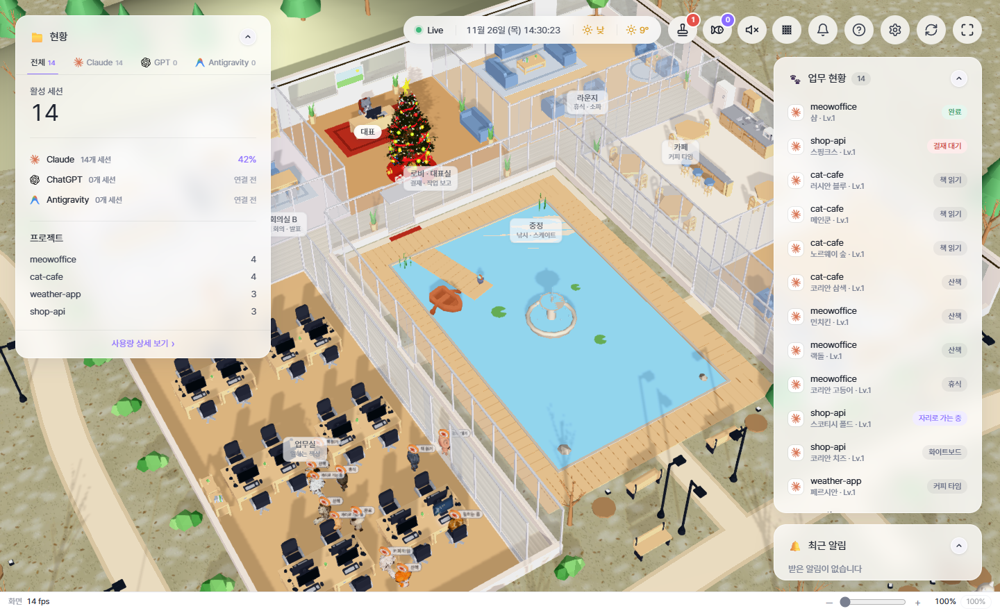
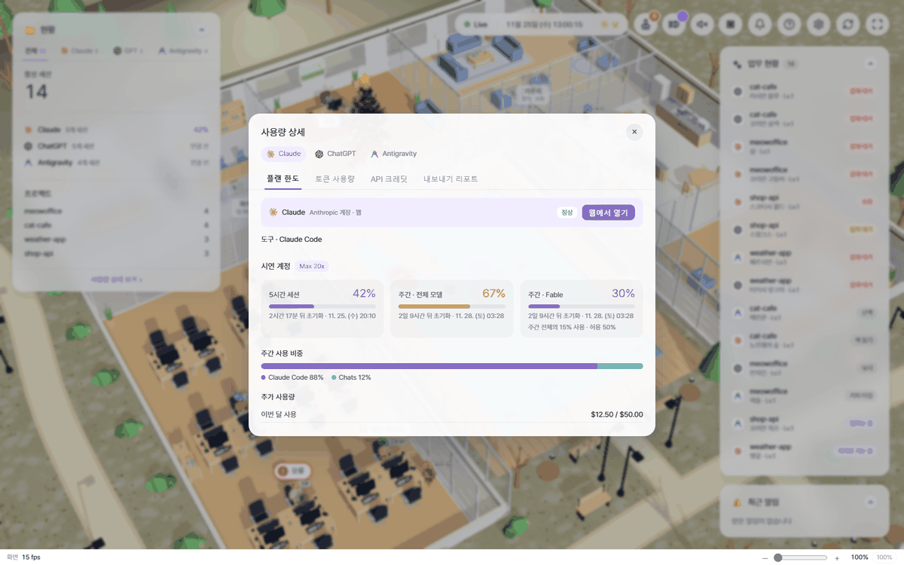
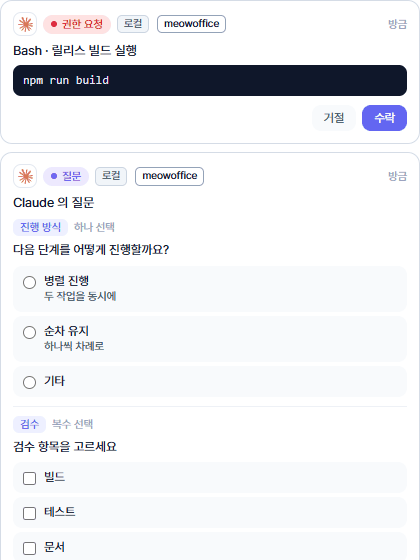

<p align="center">
  
</p>
<h1 align="center">Meowffice · 고양이사무실</h1>
<p align="center"><b>AI 코딩 세션 하나하나가 고양이 직원으로 출근합니다.</b></p>
<p align="center">
  <a href="README.md">English</a> | <b>한국어</b> | <a href="README.ja.md">日本語</a>
</p>
<p align="center">
  <a href="https://github.com/MuneoAX/meowoffice/releases/latest"></a>
  <a href="https://github.com/MuneoAX/meowoffice/releases"></a>
  
  <a href="https://github.com/MuneoAX/meowoffice"></a>
</p>

AI 코딩 세션 하나하나가 **고양이 직원**이 되어 출근하는 데스크톱 사무실입니다.
시계 옆 트레이에서 Claude Code · Codex(ChatGPT) · Antigravity 의 **사용량 한도**를 보여 주고,
세션이 권한·질문·검토를 기다리면 **알림 카드**를 띄웁니다. 3D 사무실 창에서는 일하는 세션이 고양이로 움직입니다.

Windows 10/11 · macOS (Rust + Tauri v2, 바닐라 HTML·CSS·JS, Babylon.js)

<p align="center">
  
</p>

<!-- download:start — 버전은 scripts/release.mjs 가 릴리스 때 바꾼다 -->
### ⬇ 최신 버전 v0.6.9 다운로드

| OS | 받을 파일 |
|---|---|
| Windows 10/11 | [Meowffice_0.6.9_x64-setup.exe](https://github.com/MuneoAX/meowoffice/releases/download/v0.6.9/Meowffice_0.6.9_x64-setup.exe) |
| macOS (Intel·Apple Silicon) | [Meowffice_0.6.9_universal.dmg](https://github.com/MuneoAX/meowoffice/releases/download/v0.6.9/Meowffice_0.6.9_universal.dmg) |

다른 버전은 [전체 릴리스](https://github.com/MuneoAX/meowoffice/releases), 설치 방법·주의사항은 [설치](#설치) 를 보세요.
<!-- download:end -->

> **비공식 앱입니다.** Anthropic, OpenAI, Google 과 제휴하거나 승인받지 않았습니다.
> Claude, ChatGPT, Codex, Gemini, Antigravity 는 각 회사의 상표이며, 이 앱은 어떤 서비스의 사용량인지 표시하는 데에만 이름과 로고를 씁니다.

---

## 주요 기능

- **사용량 트레이**: 5시간·주간 한도 링 게이지, 모델별 토큰 사용량(이 PC 의 로그 기준), 초기화까지 남은 시간
- **세션 알림**: 응답 완료·입력 대기·검토 대기 카드, 권한 요청을 카드에서 수락/거절(선택 기능)
- **고양이 사무실**: 세션마다 고양이 한 마리가 출근해 일하고, 결재(권한 승인)를 받으러 오고, 간식을 받으면 레벨이 오릅니다. 날씨·계절이 실제 위치를 따라갑니다
- **채팅**: 사무실 안에서 Claude Code · Codex 세션과 대화(설치된 CLI 를 그대로 사용)
- **언어**: 한국어·영어·일본어(시스템 언어를 따르고, 설정에서 바꿀 수 있음)

<table>
<tr>
<td width="50%"><br><sub><b>고양이 사무실</b></sub></td>
<td width="50%"><br><sub><b>사용량 상세</b></sub></td>
</tr>
<tr>
<td colspan="2" align="center"><br><sub><b>알림 카드</b></sub></td>
</tr>
</table>

## 설치

[최신 릴리스](https://github.com/MuneoAX/meowoffice/releases/latest) 에서 받습니다(이전 버전: [전체 릴리스](https://github.com/MuneoAX/meowoffice/releases)).

- Windows: `*-setup.exe` (코드 서명이 없어 SmartScreen 이 뜨면 "추가 정보 → 실행")
- macOS: `*.dmg` (공증이 없어 처음 한 번 Finder 에서 **우클릭 → 열기**)

사용량을 보려면 각 서비스 CLI 에 **자기 계정으로 로그인**돼 있어야 합니다(Claude Code: `claude` → `/login`, Codex: `codex login`).
앱 자체 로그인은 없습니다. 업데이트는 앱이 알아서 설치합니다.

## 개인정보

- 사용량은 이 PC 에 로그인된 각 CLI 의 정보를 읽어서 그 서비스에서만 조회합니다. 로그인 정보를 다른 곳으로 보내지 않습니다.
- 문제 제보용 로그는 설정 › 정보 › 로그 [보내기]를 직접 눌렀을 때만 보내집니다.

## 주의: 비공식 API

사용량 조회에 쓰는 `api.anthropic.com/api/oauth/*`, `/v1/sessions`, `chatgpt.com/backend-api/wham/usage` 는
각 CLI 가 내부적으로 쓰는 **공개되지 않은 주소**입니다.

- 예고 없이 바뀌어 사용량 표시가 깨질 수 있습니다.
- 서비스 약관상 허용되는지 보장하지 않습니다. 계정 제한의 위험은 사용자에게 있습니다.
- 이 앱은 토큰을 갱신(refresh)하지 않고, 각 CLI 의 설정 폴더에 토큰을 쓰지 않습니다. 사용량·세션 조회 외의 요청은 보내지 않습니다.
- Codex·Antigravity 는 설정에서 끌 수 있습니다.

## 위험할 수 있는 선택 기능 (기본 꺼짐)

| 기능 | 하는 일 | 위험 |
|---|---|---|
| Claude Code 연동(권한 요청) | `~/.claude/settings.json` 에 HTTP 훅을 추가(수정 전 백업). 권한 요청을 카드로 받음 | 훅은 `127.0.0.1` 전용이고 무작위 토큰으로 검증 |
| **자동 수락 모드** | 권한 요청을 **묻지 않고 바로 수락** | AI 의 파일 수정·명령 실행이 확인 없이 실행됩니다. 프롬프트 주입도 그대로 실행될 수 있어, 켤 때 확인 창을 띄웁니다 |
| Codex·Antigravity 훅 | 각 앱 설정에 훅 추가 | Claude Code 연동과 같음 |

## 빌드

```sh
npm ci
cd src-tauri && cargo run          # 개발 실행
npm run build                      # 설치 파일 (src-tauri/target/release/bundle/)
```

- 필요: Rust(stable), Node.js 20+, Windows 는 WebView2(11 기본 내장), macOS 는 Xcode Command Line Tools
- `ui/index.html`, `ui/notify.html`, `ui/office/index.html` 은 브라우저로 직접 열면 데모 데이터로 미리 볼 수 있습니다
- 3D 원본(.blend, 원본 glb)은 용량 때문에 공개 저장소에 넣지 않았습니다. 앱이 쓰는 최적화본은 `ui/office/models/` 에 있습니다
- 번역은 `ui/i18n/`(기준 언어 `ko`). `node scripts/i18n-check.mjs` 가 빠진 키·남은 하드코딩 문구를 알려 줍니다

태그(`v*`)를 올리면 GitHub Actions 가 Windows·macOS 설치 파일을 만들고, 업데이트 서명을 확인한 뒤 릴리스를 게시합니다(`.github/workflows/release.yml`).

## 문의

버그·제안은 [Issues](https://github.com/MuneoAX/meowoffice/issues) 에 남겨 주세요. 앱 안에서는 설정 › 정보 › 로그 [보내기]로 로그를 함께 보낼 수 있습니다.

## 라이선스

- 코드: [MIT](LICENSE) © 2026 Muneo AI Co., Ltd. (주식회사 문어AI)
- 3D 모델·소리 등 외부 자산: 각 출처의 라이선스(대부분 CC0) — [assets/licenses/](assets/licenses/)
- 고양이 3D 모델: 자체 시안으로 **Tripo** 에서 생성한 뒤 Blender 로 리깅·다듬음
- 번들된 Babylon.js: Apache-2.0 — [ui/vendor/babylon/license.md](ui/vendor/babylon/license.md)
- 번들된 Noto Sans JP(일본어 화면 글꼴): SIL OFL 1.1 — [ui/vendor/noto-sans-jp/LICENSE](ui/vendor/noto-sans-jp/LICENSE)
- 서비스 이름·로고: 각 회사의 상표 — [NOTICE.md](NOTICE.md)
