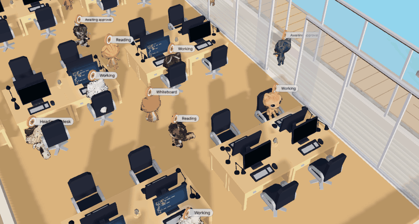
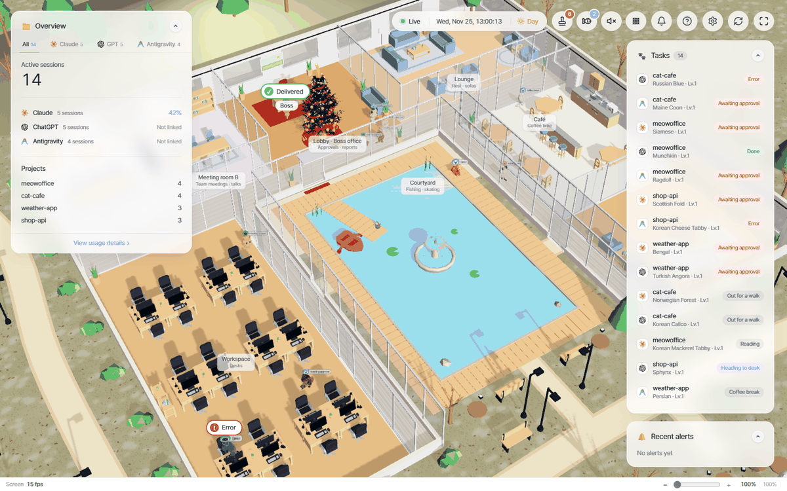
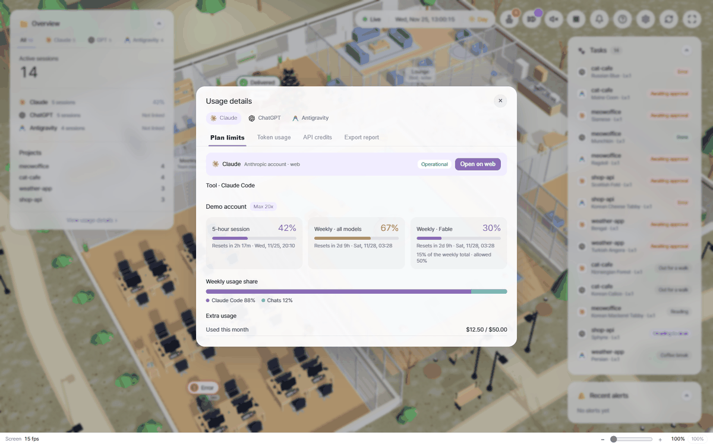
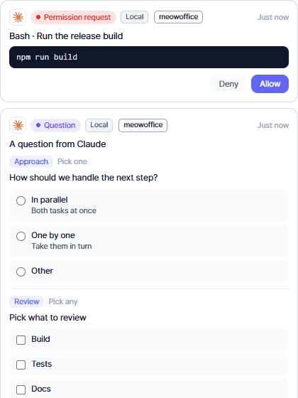

<p align="center">
  
</p>
<h1 align="center">Meowffice</h1>
<p align="center"><b>Every AI coding session clocks in as a cat employee.</b></p>
<p align="center">
  <b>English</b> | <a href="README.ko.md">한국어</a> | <a href="README.ja.md">日本語</a>
</p>
<p align="center">
  <a href="https://github.com/MuneoAX/meowoffice/releases/latest"></a>
  <a href="https://github.com/MuneoAX/meowoffice/releases"></a>
  
  <a href="https://github.com/MuneoAX/meowoffice"></a>
</p>

A desktop office where every AI coding session clocks in as a **cat employee**.
From the tray next to your clock, Meowffice shows the **usage limits** of Claude Code · Codex (ChatGPT) · Antigravity,
and pops up **alert cards** when a session is waiting for a permission, an answer, or a review. In the 3D office window, each working session moves around as a cat.

Windows 10/11 · macOS (Rust + Tauri v2, vanilla HTML·CSS·JS, Babylon.js)

<p align="center">
  
</p>

<!-- download:start — scripts/release.mjs updates the version on each release -->
### ⬇ Download the latest version v0.6.11

| OS | File |
|---|---|
| Windows 10/11 | [Meowffice_0.6.11_x64-setup.exe](https://github.com/MuneoAX/meowoffice/releases/download/v0.6.11/Meowffice_0.6.11_x64-setup.exe) |
| macOS (Intel · Apple Silicon) | [Meowffice_0.6.11_universal.dmg](https://github.com/MuneoAX/meowoffice/releases/download/v0.6.11/Meowffice_0.6.11_universal.dmg) |

Other versions: [all releases](https://github.com/MuneoAX/meowoffice/releases). See [Install](#install) for setup notes.
<!-- download:end -->

> **This is an unofficial app.** It is not affiliated with or endorsed by Anthropic, OpenAI, or Google.
> Claude, ChatGPT, Codex, Gemini, and Antigravity are trademarks of their respective owners; this app uses their names and logos only to show which service a usage figure belongs to.

---

## Features

- **Usage tray**: 5-hour and weekly limit ring gauges, per-model token usage (from this PC's logs), time until reset
- **Session alerts**: cards for finished replies, waiting for input, and waiting for review; accept/deny permission requests right from the card (optional)
- **Cat office**: one cat clocks in per session — it works, brings approvals (permission requests) to you, and levels up when you give it treats. Weather and seasons follow your real location
- **Chat**: talk to Claude Code · Codex sessions inside the office (uses the CLIs you already have installed)
- **Languages**: Korean, English, and Japanese (follows your system language; change it in Settings)

<table>
<tr>
<td width="50%"><br><sub><b>Cat office</b></sub></td>
<td width="50%"><br><sub><b>Usage details</b></sub></td>
</tr>
<tr>
<td colspan="2" align="center"><br><sub><b>Alert cards</b></sub></td>
</tr>
</table>

## Install

Download from the [latest release](https://github.com/MuneoAX/meowoffice/releases/latest) ([all releases](https://github.com/MuneoAX/meowoffice/releases)).

- Windows: `*-setup.exe` (not code-signed — if SmartScreen appears, click "More info → Run anyway")
- macOS: `*.dmg` (not notarized — the first time, **right-click → Open** in Finder)

To see usage, each service's CLI must be **signed in with your own account** (Claude Code: `claude` → `/login`, Codex: `codex login`).
The app has no login of its own. Updates install automatically from the app.

## Privacy

- Usage is read from the CLIs signed in on this PC and requested only from that service. Your sign-in data is never sent anywhere else.
- Diagnostic logs are sent only when you press Settings › About › Logs [Send] yourself.

## Caution: unofficial APIs

The addresses used to read usage — `api.anthropic.com/api/oauth/*`, `/v1/sessions`, `chatgpt.com/backend-api/wham/usage` —
are **undocumented endpoints** that each CLI uses internally.

- They may change without notice and break the usage display.
- There is no guarantee they are allowed under each service's terms. Any risk of account restrictions is yours.
- This app does not refresh tokens and never writes tokens into the CLIs' config folders. It sends no requests other than usage and session lookups.
- Codex and Antigravity can be turned off in Settings.

## Optional features that may be risky (off by default)

| Feature | What it does | Risk |
|---|---|---|
| Claude Code integration (permission requests) | Adds an HTTP hook to `~/.claude/settings.json` (backed up first) and receives permission requests as cards | The hook only listens on `127.0.0.1` and is verified with a random token |
| **Auto-accept mode** | **Accepts permission requests immediately without asking** | The AI's file edits and commands run without confirmation. Prompt injections run too, so a confirmation dialog appears when you turn it on |
| Codex · Antigravity hooks | Adds hooks to each app's settings | Same as the Claude Code integration |

## Build

```sh
npm ci
cd src-tauri && cargo run          # dev run
npm run build                      # installers (src-tauri/target/release/bundle/)
```

- Requirements: Rust (stable), Node.js 20+, WebView2 on Windows (built into Windows 11), Xcode Command Line Tools on macOS
- Open `ui/index.html`, `ui/notify.html`, or `ui/office/index.html` directly in a browser to preview with demo data
- 3D sources (.blend, original glb) are not in the public repo because of their size. The optimized models the app uses are in `ui/office/models/`
- Translations live in `ui/i18n/` (`ko` is the base language). `node scripts/i18n-check.mjs` reports missing keys and leftover hard-coded text

Pushing a tag (`v*`) makes GitHub Actions build the Windows and macOS installers, verify the update signatures, and publish the release (`.github/workflows/release.yml`).

## Contact

Please report bugs and ideas in [Issues](https://github.com/MuneoAX/meowoffice/issues). In the app, Settings › About › Logs [Send] lets you attach your logs.

## License

- Code: [MIT](LICENSE) © 2026 Muneo AI Co., Ltd.
- 3D models, sounds, and other third-party assets: each source's license (mostly CC0) — [assets/licenses/](assets/licenses/)
- Cat 3D models: generated with **Tripo** from our own concept art, then rigged and refined in Blender
- Bundled Babylon.js: Apache-2.0 — [ui/vendor/babylon/license.md](ui/vendor/babylon/license.md)
- Bundled Noto Sans JP (Japanese UI font): SIL OFL 1.1 — [ui/vendor/noto-sans-jp/LICENSE](ui/vendor/noto-sans-jp/LICENSE)
- Service names and logos: trademarks of their owners — [NOTICE.md](NOTICE.md)
